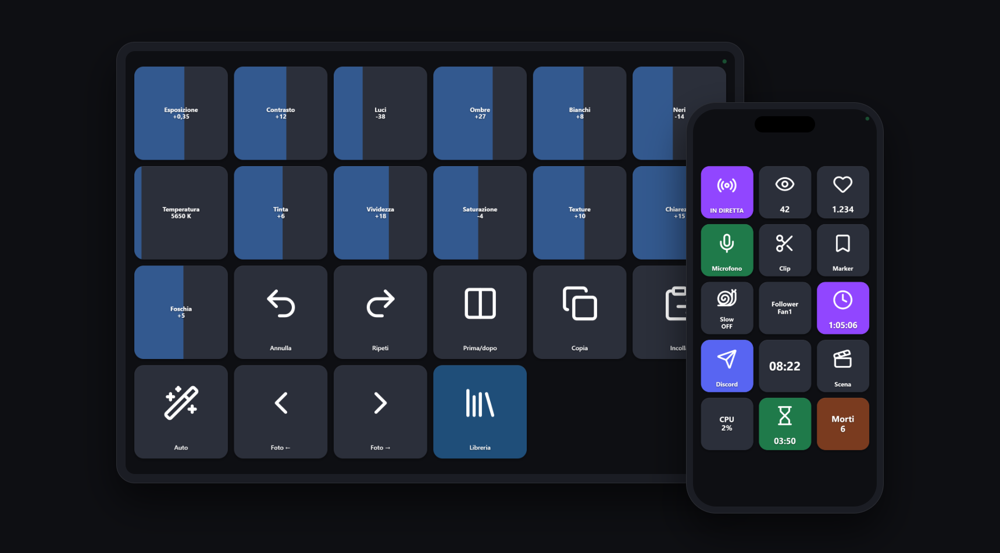
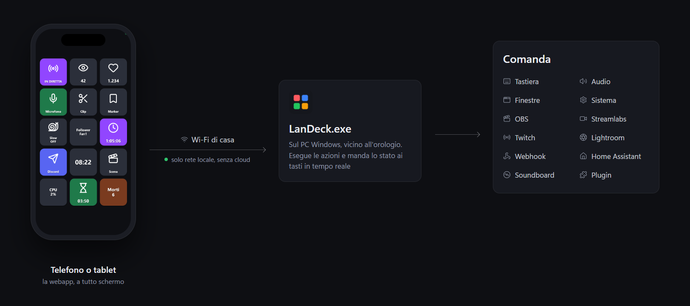
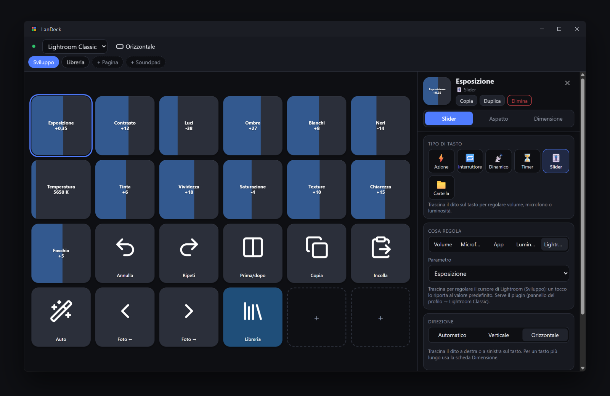

  

<h1 align="center">LanDeck</h1>

  Un pannello di tasti per il PC Windows, sul telefono o sul tablet che hai già 
  iPhone, iPad, Android o qualsiasi browser · nella rete di casa · senza cloud e senza account

  <a href="../../releases/latest"><b>Scarica LanDeck.exe</b></a> · Windows 10 e 11

  

---

## Cosa fa

Tocchi un tasto sul telefono e il PC esegue l'azione: una scorciatoia, un programma, il muto del microfono, il cambio di scena in OBS, una clip su Twitch, un cursore di Lightroom… I tasti possono anche **mostrare informazioni in tempo reale**: sei in diretta? quanti spettatori ci sono? quanto vale l'esposizione della foto?

- **Sul PC** gira `LanDeck.exe`: un unico file, senza bisogno di .NET. Vive come icona vicino all'orologio.
- **Sul telefono** apri la pagina indicata da LanDeck e la aggiungi alla schermata Home: diventa un'app a tutto schermo.
- **Solo rete locale**: nessun dato esce da casa. Fanno eccezione solo i servizi che scegli tu (meteo, Twitch, Streamlabs, webhook).

## Requisiti

- PC con **Windows 10 o 11** (64 bit).
- Telefono o tablet (**iPhone, iPad, Android**) sulla **stessa rete Wi-Fi** del PC.

## Installazione

1. Scarica `LanDeck.exe` dalla [pagina delle release](../../releases/latest) e avvialo, anche dalla cartella Download.
2. Scegli **«Installa LanDeck»**. Il programma:
   - si copia in `%LOCALAPPDATA%\Programs\LanDeck`;
   - crea il collegamento nel **menu Start** e la voce in **Impostazioni → App**;
   - si avvia con Windows.

   Non servono permessi di amministratore e il file scaricato si può cancellare. Con «Avvia senza installare» funziona anche come programma portatile, ma senza aggiornamenti automatici.
3. Al primo avvio:
   - chiede di creare una **regola del firewall di Windows**: serve l'autorizzazione di amministratore, una volta sola, e la regola accetta solo la rete locale;
   - mostra **indirizzo, QR code e codice di accoppiamento**.
4. Inquadra il QR code con la fotocamera del telefono e tocca il link: il dispositivo viene associato e mostra subito i tasti. In alternativa apri l'indirizzo mostrato (es. `http://192.168.1.10:8765`) e scrivi il codice a 6 cifre.
5. **Come app a tutto schermo**:
   - **iPhone/iPad**: in Safari tocca *Condividi → Aggiungi alla schermata Home*.
   - **Android**: Chrome installa le app solo da siti HTTPS, quindi va autorizzato una volta. Dopo l'accoppiamento LanDeck mostra la guida passo passo. In breve:
     1. apri `chrome://flags/#unsafely-treat-insecure-origin-as-secure`;
     2. incolla l'indirizzo di LanDeck, imposta *Enabled* e tocca *Relaunch*;
     3. dal menu **⋮** scegli *Installa app*.

> Windows potrebbe mostrare l'avviso SmartScreen ("PC protetto") perché l'exe non è firmato: *Ulteriori informazioni → Esegui comunque*.

## Aggiornamenti automatici

LanDeck installato controlla le nuove versioni **all'avvio e ogni 6 ore**. Quando ce n'è una compare una notifica vicino all'orologio: aprila (o dal menu dell'icona scegli *Installa aggiornamento…*) per leggere le novità e premi **«Installa e riavvia»**.

LanDeck scarica la nuova versione, ne verifica l'integrità (SHA-256) e si riapre da solo in pochi secondi. Tasti, impostazioni, dispositivi e firewall restano come prima.

## L'editor sul PC

I tasti **si creano e si modificano dal PC**: clic sull'icona di LanDeck vicino all'orologio, oppure menu dell'icona → *Apri editor…*. Le modifiche arrivano subito su tutti i dispositivi collegati.

- **Creare e spostare**: tocca una cella vuota (+) per creare un tasto, trascinalo per spostarlo (sopra un altro tasto li scambia). Ctrl+C / Ctrl+V / Ctrl+D / Canc funzionano.
- **Organizzare**:
  - **profili** (es. "Lavoro", "Giochi", "Streaming"), ognuno con **pagine** e **cartelle**;
  - **griglia** separata per verticale e orizzontale, con spazi, margini e tasti grandi su più celle.
- **Aspetto**: testo, emoji, migliaia di icone, immagini, colori e sfondi.
  - **«Cerca online»** trova icone e foto senza uscire dall'editor.
  - Con «Apri programma» l'icona del programma viene presa da sola.
- **Esporta/Importa** un profilo su file, immagini comprese.
- **Profili automatici**: quando un programma (Photoshop, OBS, Lightroom, un gioco…) è in primo piano, i dispositivi passano da soli al suo profilo.

Sul telefono, tieni premuto il puntino di stato in alto per cambiare profilo o pagina e per tenere lo schermo acceso.

## Tipi di tasto

| Tipo | Cosa fa |
|---|---|
| **Azione** | Esegue un'azione al tocco, e un'altra diversa tenendolo premuto. |
| **Interruttore** | Alterna ON/OFF a ogni tocco, con azioni e aspetto diversi per i due stati. |
| **Dinamico** | Mostra dati in tempo reale e cambia colore, testo o icona in base allo stato. |
| **Timer** | Conto alla rovescia o cronometro sul tasto: tocca per avviare o fermare, tieni premuto per azzerare. |
| **Slider** | Trascina il dito per regolare volume, microfono, volume di un'app, luminosità o un cursore di Lightroom. |
| **Cartella** | Apre una sotto-griglia di tasti. |

## Azioni

| Azione | Esempi |
|---|---|
| **Scorciatoia da tastiera** | Ctrl+Shift+S, Win+D… (si registra premendo i tasti) |
| **Apri programma, file, cartella o URL** | Se il programma è già aperto: apri un'altra finestra, portalo davanti o chiudilo |
| **Scrivi un testo** | Nella finestra attiva, con accenti ed emoji |
| **Multimedia e volume** | Play/pausa, tracce, volume generale, **volume di una singola app** (Spotify, Discord…) |
| **Microfono e uscita audio** | Muto del microfono; passa da cuffie a casse con un tocco |
| **Soundboard e Soundpad** | Suoni mp3/wav/m4a. Le pagine **Soundpad** li fanno sentire anche agli altri su Discord, insieme alla tua voce, tramite VB-CABLE, che LanDeck installa per te |
| **Sistema** | Blocco, sospensione, spegnimento (con conferma), screenshot, desktop virtuali, luminosità |
| **Gestione finestre** | Primo piano, massimizza, affianca, sposta sull'altro schermo, sempre in primo piano |
| **Comando o script** | Prompt dei comandi o PowerShell |
| **Macro** | Una sequenza di azioni con attese |
| **Contatore e timer** | Condivisi fra tutti i dispositivi |
| **OBS Studio / Streamlabs Desktop** | Diretta, registrazione, replay, scene, muto delle sorgenti |
| **Twitch** | Marker, clip, titolo e categoria, pubblicità, chat, annunci, shoutout, raid, modalità chat, sondaggi e pronostici |
| **Streamlabs** | Alert personalizzato nell'Alert Box |
| **Lightroom Classic** | Cursori di Sviluppo, preset, copia/incolla, stelle, bandierine, etichette |
| **Richiesta HTTP / webhook** | Discord, Telegram, ntfy, Home Assistant, Shelly o qualsiasi API |
| **Navigazione** | Cambia pagina o profilo |
| **Plugin** | Azioni aggiunte da te o da altri |

## Tasti dinamici

Mostrano in tempo reale:
- orologio, data, meteo, CPU, RAM;
- timer e contatori;
- volume, microfono, uscita audio;
- stato di OBS o Streamlabs Desktop;
- dati di Twitch (in diretta, spettatori, follower, ultimo follower/sub/raid, durata della diretta);
- ultima donazione di Streamlabs;
- valori di Lightroom («Esposizione +0,35», stelle, bandierina);
- un valore preso da un indirizzo web qualsiasi;
- i dati dei plugin.

Con le **regole** cambiano aspetto: viola quando sei in diretta, icona barrata con il microfono muto, rosso quando la CPU supera l'80%… Ci sono **modelli pronti** da applicare con un tocco.

## Integrazioni

### OBS Studio e Streamlabs Desktop
- **OBS** (versione 28 o successiva): in OBS attiva *Strumenti → Impostazioni server WebSocket → Abilita*. Se c'è una password, inseriscila nell'editor (pannello del profilo → OBS Studio).
- **Streamlabs Desktop**: si collega da solo appena è aperto. Nelle azioni e nei tasti OBS scegli «Streamlabs Desktop».

### Twitch
- Accedi dal pannello del profilo → Twitch con un **codice da confermare su twitch.tv/activate**: LanDeck non vede mai la password.
- Oltre alle azioni e ai tasti dinamici, gli **eventi in tempo reale** possono far lampeggiare un tasto o avviare un'azione o una macro, anche con un messaggio in chat «Grazie {utente}!». Eventi: nuovi follower, abbonamenti, raid, bits, riscatti di punti canale.
- La prima volta serve registrare un'app gratuita su [dev.twitch.tv/console](https://dev.twitch.tv/console) (tipo di client «Public») e incollare il Client ID nell'editor.

### Streamlabs (alert e donazioni)
Incolla i token presi dalla dashboard di Streamlabs (*Settings → API Settings → API Tokens*). Funziona anche con OBS.
- Donazioni ed eventi di Twitch e YouTube possono far lampeggiare un tasto o avviare un'azione.
- Tasti con l'ultima donazione e il totale della serata.
- Azione «Alert personalizzato».

### Lightroom Classic
1. Nel pannello del profilo → Lightroom Classic premi **«Installa plugin Lightroom»** e riavvia Lightroom.
2. Con **«+ Lightroom»** crei un profilo già pronto: slider per esposizione, contrasto, luci, ombre, temperatura…, più stelle, bandierine ed etichette. Si attiva da solo quando Lightroom è in primo piano.

Sul telefono trascini il dito e il cursore si muove in modo fluido; un tocco lo riporta a zero.

### Webhook e richieste HTTP
Manda un messaggio su Discord, Telegram o ntfy, accendi una luce con Home Assistant o una presa Shelly, oppure chiama qualsiasi API.
- **Modelli pronti** guidano la configurazione.
- Le **variabili** inseriscono dati nel testo: `{ora}`, `{data}`, `{appunti}`, contatori e timer.
- Un tasto dinamico può interrogare un indirizzo ogni tot secondi e mostrare un valore dalla risposta.

### Credenziali al sicuro
Token, chiavi e password (Twitch, Streamlabs, webhook, OBS) restano **solo sul PC, cifrati con la protezione di Windows**. Non arrivano mai al telefono e non finiscono nei profili esportati: nei tasti si scrive `{segreto:Nome}`.

### Plugin
Ogni cartella in `%APPDATA%\LanDeck\plugins` con un file `plugin.json` aggiunge azioni e tasti dinamici, in PowerShell, Python, Node o qualsiasi altro linguaggio, senza ricompilare LanDeck.
- La guida (`PLUGIN.md`) e un esempio sono già in quella cartella.
- Dopo le modifiche: menu dell'icona → *Plugin → Ricarica plugin*.

## Menu dell'icona sul PC

Clic sull'icona: si apre l'**editor**. Clic destro:

- **Mostra indirizzo e QR code…**: per associare un nuovo dispositivo.
- **Apri editor…**
- **Dispositivi associati**: con «Revoca accesso…».
- **Avvia con Windows**, **Configura firewall…**, **Cambia porta…**
- **Apri cartella dei dati**, **Plugin**.
- **Cerca aggiornamenti**, **Disinstalla LanDeck…**, **Esci**.

## Dati e disinstallazione

- I dati (configurazione, immagini, plugin) sono in `%APPDATA%\LanDeck`; il programma in `%LOCALAPPDATA%\Programs\LanDeck`.
- **Disinstallare**: *Impostazioni → App → LanDeck → Disinstalla*, oppure menu dell'icona → *Disinstalla LanDeck…*.
  - Rimuove programma, collegamento, avvio automatico e regola del firewall.
  - Puoi scegliere se eliminare anche tasti e impostazioni.

## Problemi comuni

- **Il telefono non si collega**: PC e telefono devono essere sulla stessa rete Wi-Fi, non quella "ospiti". Controlla anche la regola del firewall (menu dell'icona → *Configura firewall…*).
- **I tasti non funzionano in un programma avviato come amministratore**: Windows blocca l'invio di tasti verso i programmi con privilegi elevati.
- **Con il PC bloccato** non si possono inviare scorciatoie e testo.
- **Volume di un'app**: l'app compare solo dopo aver riprodotto almeno un suono.
- **Luminosità di un monitor esterno**: attiva "DDC/CI" nel menu del monitor.
- **Twitch, Streamlabs, Lightroom**: il pannello dell'integrazione nell'editor mostra lo stato e l'ultimo errore.

## Sicurezza

- Accetta connessioni **solo dalla rete locale**. Le integrazioni con OBS, Streamlabs Desktop e Lightroom restano sul PC (127.0.0.1).
- Ogni dispositivo va **associato** con un codice temporaneo e si può revocare in qualsiasi momento.
- I tasti si modificano dall'**editor sul PC**. Un telefono associato invia solo «ho premuto il tasto X»: cosa eseguire lo decide il PC, leggendolo dalla propria configurazione.
- Token e chiavi sono **cifrati sul PC** e non escono mai verso i dispositivi.
