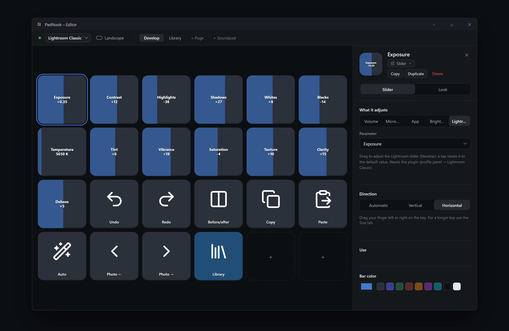
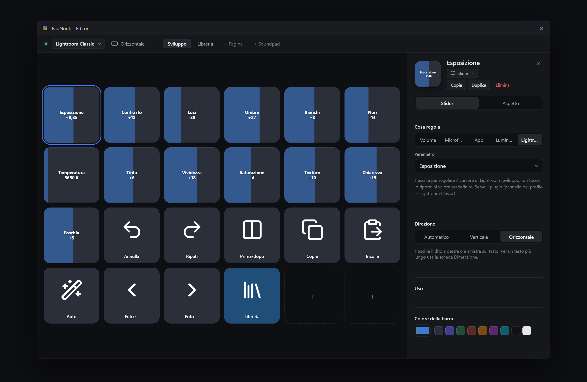

  

<h1 align="center">PadNook</h1>

  A touch macro pad for your Windows PC, on the phone or tablet you already own 
  iPhone, iPad, Android or any browser · on your home network · no cloud, no account

  <a href="../../releases/latest"><b>Download PadNook.exe</b></a> · Windows 10 and 11 · Freeware

  <a href="#english">English</a> · <a href="#italiano">Italiano</a>

  

---

# English

> PadNook is in English and Italian. Phones and tablets follow the device language, the PC follows the Windows display language; you can change it from the device menu, the editor's Profile tab or the icon menu (*Lingua · Language*).

## What it does

Tap a key on your phone and the PC runs the action: a keyboard shortcut, a program, muting the microphone, switching scene in OBS, a Twitch clip, a Lightroom slider… Keys can also **show live information**: are you live? how many viewers are watching? what is the exposure of this photo?

- **On the PC** runs `PadNook.exe`: a single file, no .NET install needed. It lives as an icon next to the clock.
- **On the phone** you open the page shown by PadNook and add it to the Home screen: it becomes a full-screen app.
- **Local network only**: no data leaves your home, except for the services you choose to use (weather, Twitch, Streamlabs, webhooks).

## Requirements

- A PC with **Windows 10 or 11** (64-bit).
- A phone or tablet (**iPhone, iPad, Android**) on the **same Wi-Fi network** as the PC.

## Installation

1. Download `PadNook.exe` from the [releases page](../../releases/latest) and run it, even straight from the Downloads folder.
2. Choose **“Install PadNook”**. The program:
   - copies itself to `%LOCALAPPDATA%\Programs\PadNook`;
   - adds a **Start menu** shortcut and an entry in **Settings → Apps**;
   - starts with Windows.

   No administrator rights are needed, and you can delete the downloaded file afterwards. With “Run without installing” it also works as a portable program, without automatic updates.
3. On first start it:
   - asks to create a **Windows Firewall rule**. This needs administrator approval once, and the rule only accepts the local network;
   - shows the **address, a QR code and a pairing code**.
4. Scan the QR code with the phone camera and tap the link: the device is paired and shows the keys right away. Alternatively, open the address shown (e.g. `http://192.168.1.10:8765`) and type the 6-digit code.
5. **As a full-screen app**:
   - **iPhone/iPad**: in Safari tap *Share → Add to Home Screen*.
   - **Android**: Chrome only installs apps from HTTPS sites, so it needs a one-time permission. After pairing, PadNook shows a step-by-step guide. In short:
     1. open `chrome://flags/#unsafely-treat-insecure-origin-as-secure`;
     2. paste the PadNook address, set *Enabled* and tap *Relaunch*;
     3. choose *Install app* from the **⋮** menu.

> Windows may show the SmartScreen warning ("Windows protected your PC") because the exe is not signed: *More info → Run anyway*.

## Automatic updates

Once installed, PadNook checks for new versions **at startup and every 6 hours**. When there is one, a notification appears next to the clock. Open it, or choose *Install update…* from the icon menu, to read what's new, then press **“Install and restart”**.

PadNook downloads the new version, checks its integrity (SHA-256) and restarts by itself in a few seconds. Keys, settings, devices and the firewall rule stay as they were.

## The editor on the PC

Keys are **created and edited on the PC**: click the PadNook icon next to the clock, or choose *Open editor…* from the icon menu. Changes reach every connected device instantly.

- **Create and move**: click an empty cell (+) to create a key, drag a key to move it (dropping it on another key swaps them). Ctrl+C / Ctrl+V / Ctrl+D / Del work.
- **Organize**:
  - **profiles** (e.g. "Work", "Games", "Streaming"), each with **pages** and **folders**;
  - a separate **grid** for portrait and landscape, with spacing, margins and large keys spanning several cells.
- **Look**: text, emoji, thousands of icons, images, colors and backgrounds.
  - **“Search online”** finds icons and photos without leaving the editor.
  - With “Open program, file, folder or URL” the program's own icon is used automatically.
- **Export/Import** a profile to a file, images included.
- **Automatic profiles**: when a program (Photoshop, OBS, Lightroom, a game…) is in the foreground, devices switch to its profile by themselves.

On the phone, press and hold the status dot at the top to change profile or page and to keep the screen on.

## Key types

| Type | What it does |
|---|---|
| **Action** | Runs an action on tap, and a different one on long press. |
| **Toggle** | Switches ON/OFF at every tap, with different actions and looks for the two states. |
| **Dynamic** | Shows live data and changes color, text or icon based on the state. |
| **Timer** | Countdown or stopwatch on the key: tap to start or stop, long press to reset. |
| **Slider** | Drag your finger to set volume, microphone, the volume of one app, brightness or a Lightroom slider. |
| **Folder** | Opens a sub-grid of keys. |

## Actions

| Action | Examples |
|---|---|
| **Keyboard shortcut** | Ctrl+Shift+S, Win+D… (recorded by pressing the keys) |
| **Open program, file, folder or URL** | If the program is already open: open another window, bring it to front or close it |
| **Type text** | Into the active window, accents and emoji included |
| **Media and volume** | Play/pause, tracks, master volume, **volume of a single app** (Spotify, Discord…) |
| **Microphone and audio output** | Mute the microphone; switch between headphones and speakers in one tap |
| **Soundboard and Soundpad** | mp3/wav/m4a sounds. **Soundpad** pages also play them to others on Discord together with your voice, through VB-CABLE, which PadNook installs for you |
| **System** | Lock, sleep, shut down (with confirmation), screenshots, virtual desktops, brightness |
| **Window management** | Bring to front, maximize, snap, move to the other screen, always on top |
| **Command or script** | Command Prompt or PowerShell |
| **Macro** | A sequence of actions with waits |
| **Counter and timer** | Shared by all devices |
| **OBS Studio / Streamlabs Desktop** | Stream, recording, replay, scenes, source mute |
| **Twitch** | Markers, clips, title and category, ads, chat, announcements, shoutouts, raids, chat modes, polls and predictions |
| **Streamlabs** | Custom alert in the Alert Box |
| **Lightroom Classic** | Develop sliders, presets, copy/paste settings, ratings, flags, color labels |
| **HTTP request / webhook** | Discord, Telegram, ntfy, Home Assistant, Shelly or any API |
| **Navigation** | Change page or profile |
| **Plugin** | Actions added by you or by others |

## Dynamic keys

They show live:
- clock, date, weather, CPU, RAM;
- timers and counters;
- volume, microphone, audio output;
- OBS or Streamlabs Desktop status;
- Twitch data (live, viewers, followers, latest follower/sub/raid, stream uptime);
- the latest Streamlabs donation;
- Lightroom values (“Exposure +0.35”, rating, flag);
- a value taken from any web address;
- plugin data.

With **rules** they change look: purple while you are live, a crossed-out icon when the microphone is muted, red when the CPU goes over 80%… **Ready-made templates** apply in one click.

## Integrations

### OBS Studio and Streamlabs Desktop
- **OBS** (version 28 or later): in OBS enable *Tools → WebSocket Server Settings → Enable*. If you set a password, enter it in the editor (profile panel → OBS Studio).
- **Streamlabs Desktop**: connects by itself as soon as it is open. In OBS actions and keys choose “Streamlabs Desktop”.

### Twitch
- Sign in from the profile panel → Twitch with a **code to confirm on twitch.tv/activate**: PadNook never sees your password.
- Besides actions and dynamic keys, **live events** can flash a key or run an action or a macro, even a chat message such as "Thanks {utente}!". Events: new followers, subscriptions, raids, bits, channel point redemptions.
- The first time, register a free app on [dev.twitch.tv/console](https://dev.twitch.tv/console) (client type "Public") and paste its Client ID in the editor.

### Streamlabs (alerts and donations)
Paste the tokens from the Streamlabs dashboard (*Settings → API Settings → API Tokens*). Works with OBS too.
- Donations and Twitch and YouTube events can flash a key or run an action.
- Keys with the latest donation and the total of the night.
- “Custom alert” action.

### Lightroom Classic
1. In the profile panel → Lightroom Classic press **“Install Lightroom plugin”** and restart Lightroom.
2. **“+ Lightroom”** creates a ready-made profile: sliders for exposure, contrast, highlights, shadows, temperature…, plus ratings, flags and color labels. It turns on by itself when Lightroom is in the foreground.

On the phone you drag your finger and the slider moves smoothly; a tap resets it.

### Webhooks and HTTP requests
Send a message to Discord, Telegram or ntfy, turn on a light with Home Assistant or a Shelly plug, or call any API.
- **Ready-made templates** guide the setup.
- **Variables** insert data into the text: `{ora}` (time), `{data}` (date), `{appunti}` (clipboard), counters and timers.
- A dynamic key can query an address every few seconds and show a value from the response.

### Credentials kept safe
Tokens, keys and passwords (Twitch, Streamlabs, webhooks, OBS) stay **only on the PC, encrypted with Windows data protection**. They never reach the phone and never end up in exported profiles: keys use `{segreto:Name}` instead.

### Plugins
Every folder in `%APPDATA%\PadNook\plugins` with a `plugin.json` file adds actions and dynamic keys, in PowerShell, Python, Node or any other language, without rebuilding PadNook.
- The guide (`PLUGIN.md`) and an example are already in that folder.
- After a change: icon menu → *Plugin → Ricarica plugin* (reload plugins).

## The tray icon menu

Click the icon to open the **editor**. Right click:

- **Show address and QR code…**: to pair a new device.
- **Open editor…**
- **Paired devices**: with “Revoke access…”.
- **Start with Windows**, **Configure firewall…**, **Change port…**
- **Open data folder**, **Plugins**.
- **Check for updates**, **Uninstall PadNook…**, **Lingua · Language**, **License and credits…**, **Exit**.

## Data and uninstalling

- The data (configuration, images, plugins) is in `%APPDATA%\PadNook`; the program in `%LOCALAPPDATA%\Programs\PadNook`.
- **Uninstall**: *Settings → Apps → PadNook → Uninstall*, or icon menu → *Disinstalla PadNook…*.
  - It removes the program, the shortcut, the autostart entry and the firewall rule.
  - You can choose whether to delete keys and settings too.

## Troubleshooting

- **The phone does not connect**: PC and phone must be on the same Wi-Fi network, not the "guest" one. Also check the firewall rule (icon menu → *Configure firewall…*).
- **Keys do not work in a program run as administrator**: Windows blocks sending keys to programs with elevated privileges.
- **While the PC is locked**, shortcuts and text cannot be sent.
- **App volume**: an app appears only after it has played at least one sound.
- **Brightness of an external monitor**: enable "DDC/CI" in the monitor menu.
- **Twitch, Streamlabs, Lightroom**: the integration panel in the editor shows the status and the last error.

## Security

- It only accepts connections **from the local network**. The integrations with OBS, Streamlabs Desktop and Lightroom stay on the PC (127.0.0.1).
- Every device must be **paired** with a temporary code and can be revoked at any time.
- Keys are edited in the **editor on the PC**. A paired phone only sends "I pressed key X": what to run is decided by the PC, from its own configuration.
- Tokens and keys are **encrypted on the PC** and never travel to the devices.

## License

PadNook is **freeware**: free for personal and commercial use, not open source. You may share the original `PadNook.exe` unchanged and free of charge. See [LICENSE.md](LICENSE.md).

It includes open source components (MIT, ISC, BSD) listed in [THIRD-PARTY-NOTICES.md](THIRD-PARTY-NOTICES.md).

The Soundpad's virtual microphone uses **[VB-CABLE](https://vb-audio.com/Cable/) by VB-Audio Software**. It is donationware with its own license and is not part of PadNook: PadNook downloads it from the official VB-Audio website only when you ask for it. If you use it, please consider supporting its author. Weather data by [Open-Meteo.com](https://open-meteo.com/) (CC BY 4.0).

The names of other products are trademarks of their owners. PadNook is not affiliated with them.

---

# Italiano

  Un macro pad touch per il PC Windows, sul telefono o sul tablet che hai già 
  <a href="../../releases/latest"><b>Scarica PadNook.exe</b></a> · Windows 10 e 11 · Freeware

> PadNook è in italiano e in inglese. Telefoni e tablet seguono la lingua del dispositivo, il PC quella di Windows; puoi cambiarla dal menu del dispositivo, dalla scheda Profilo dell'editor o dal menu dell'icona (*Lingua · Language*).

## Cosa fa

Tocchi un tasto sul telefono e il PC esegue l'azione: una scorciatoia, un programma, il muto del microfono, il cambio di scena in OBS, una clip su Twitch, un cursore di Lightroom… I tasti possono anche **mostrare informazioni in tempo reale**: sei in diretta? quanti spettatori ci sono? quanto vale l'esposizione della foto?

- **Sul PC** gira `PadNook.exe`: un unico file, senza bisogno di .NET. Vive come icona vicino all'orologio.
- **Sul telefono** apri la pagina indicata da PadNook e la aggiungi alla schermata Home: diventa un'app a tutto schermo.
- **Solo rete locale**: nessun dato esce da casa. Fanno eccezione solo i servizi che scegli tu (meteo, Twitch, Streamlabs, webhook).

## Requisiti

- PC con **Windows 10 o 11** (64 bit).
- Telefono o tablet (**iPhone, iPad, Android**) sulla **stessa rete Wi-Fi** del PC.

## Installazione

1. Scarica `PadNook.exe` dalla [pagina delle release](../../releases/latest) e avvialo, anche dalla cartella Download.
2. Scegli **«Installa PadNook»**. Il programma:
   - si copia in `%LOCALAPPDATA%\Programs\PadNook`;
   - crea il collegamento nel **menu Start** e la voce in **Impostazioni → App**;
   - si avvia con Windows.

   Non servono permessi di amministratore e il file scaricato si può cancellare. Con «Avvia senza installare» funziona anche come programma portatile, ma senza aggiornamenti automatici.
3. Al primo avvio:
   - chiede di creare una **regola del firewall di Windows**: serve l'autorizzazione di amministratore, una volta sola, e la regola accetta solo la rete locale;
   - mostra **indirizzo, QR code e codice di accoppiamento**.
4. Inquadra il QR code con la fotocamera del telefono e tocca il link: il dispositivo viene associato e mostra subito i tasti. In alternativa apri l'indirizzo mostrato (es. `http://192.168.1.10:8765`) e scrivi il codice a 6 cifre.
5. **Come app a tutto schermo**:
   - **iPhone/iPad**: in Safari tocca *Condividi → Aggiungi alla schermata Home*.
   - **Android**: Chrome installa le app solo da siti HTTPS, quindi va autorizzato una volta. Dopo l'accoppiamento PadNook mostra la guida passo passo. In breve:
     1. apri `chrome://flags/#unsafely-treat-insecure-origin-as-secure`;
     2. incolla l'indirizzo di PadNook, imposta *Enabled* e tocca *Relaunch*;
     3. dal menu **⋮** scegli *Installa app*.

> Windows potrebbe mostrare l'avviso SmartScreen ("PC protetto") perché l'exe non è firmato: *Ulteriori informazioni → Esegui comunque*.

## Aggiornamenti automatici

PadNook installato controlla le nuove versioni **all'avvio e ogni 6 ore**. Quando ce n'è una compare una notifica vicino all'orologio: aprila (o dal menu dell'icona scegli *Installa aggiornamento…*) per leggere le novità e premi **«Installa e riavvia»**.

PadNook scarica la nuova versione, ne verifica l'integrità (SHA-256) e si riapre da solo in pochi secondi. Tasti, impostazioni, dispositivi e firewall restano come prima.

## L'editor sul PC

I tasti **si creano e si modificano dal PC**: clic sull'icona di PadNook vicino all'orologio, oppure menu dell'icona → *Apri editor…*. Le modifiche arrivano subito su tutti i dispositivi collegati.

- **Creare e spostare**: tocca una cella vuota (+) per creare un tasto, trascinalo per spostarlo (sopra un altro tasto li scambia). Ctrl+C / Ctrl+V / Ctrl+D / Canc funzionano.
- **Organizzare**:
  - **profili** (es. "Lavoro", "Giochi", "Streaming"), ognuno con **pagine** e **cartelle**;
  - **griglia** separata per verticale e orizzontale, con spazi, margini e tasti grandi su più celle.
- **Aspetto**: testo, emoji, migliaia di icone, immagini, colori e sfondi.
  - **«Cerca online»** trova icone e foto senza uscire dall'editor.
  - Con «Apri programma» l'icona del programma viene presa da sola.
- **Esporta/Importa** un profilo su file, immagini comprese.
- **Profili automatici**: quando un programma (Photoshop, OBS, Lightroom, un gioco…) è in primo piano, i dispositivi passano da soli al suo profilo.

Sul telefono, tieni premuto il puntino di stato in alto per cambiare profilo o pagina e per tenere lo schermo acceso.

## Tipi di tasto

| Tipo | Cosa fa |
|---|---|
| **Azione** | Esegue un'azione al tocco, e un'altra diversa tenendolo premuto. |
| **Interruttore** | Alterna ON/OFF a ogni tocco, con azioni e aspetto diversi per i due stati. |
| **Dinamico** | Mostra dati in tempo reale e cambia colore, testo o icona in base allo stato. |
| **Timer** | Conto alla rovescia o cronometro sul tasto: tocca per avviare o fermare, tieni premuto per azzerare. |
| **Slider** | Trascina il dito per regolare volume, microfono, volume di un'app, luminosità o un cursore di Lightroom. |
| **Cartella** | Apre una sotto-griglia di tasti. |

## Azioni

| Azione | Esempi |
|---|---|
| **Scorciatoia da tastiera** | Ctrl+Shift+S, Win+D… (si registra premendo i tasti) |
| **Apri programma, file, cartella o URL** | Se il programma è già aperto: apri un'altra finestra, portalo davanti o chiudilo |
| **Scrivi un testo** | Nella finestra attiva, con accenti ed emoji |
| **Multimedia e volume** | Play/pausa, tracce, volume generale, **volume di una singola app** (Spotify, Discord…) |
| **Microfono e uscita audio** | Muto del microfono; passa da cuffie a casse con un tocco |
| **Soundboard e Soundpad** | Suoni mp3/wav/m4a. Le pagine **Soundpad** li fanno sentire anche agli altri su Discord, insieme alla tua voce, tramite VB-CABLE, che PadNook installa per te |
| **Sistema** | Blocco, sospensione, spegnimento (con conferma), screenshot, desktop virtuali, luminosità |
| **Gestione finestre** | Primo piano, massimizza, affianca, sposta sull'altro schermo, sempre in primo piano |
| **Comando o script** | Prompt dei comandi o PowerShell |
| **Macro** | Una sequenza di azioni con attese |
| **Contatore e timer** | Condivisi fra tutti i dispositivi |
| **OBS Studio / Streamlabs Desktop** | Diretta, registrazione, replay, scene, muto delle sorgenti |
| **Twitch** | Marker, clip, titolo e categoria, pubblicità, chat, annunci, shoutout, raid, modalità chat, sondaggi e pronostici |
| **Streamlabs** | Alert personalizzato nell'Alert Box |
| **Lightroom Classic** | Cursori di Sviluppo, preset, copia/incolla, stelle, bandierine, etichette |
| **Richiesta HTTP / webhook** | Discord, Telegram, ntfy, Home Assistant, Shelly o qualsiasi API |
| **Navigazione** | Cambia pagina o profilo |
| **Plugin** | Azioni aggiunte da te o da altri |

## Tasti dinamici

Mostrano in tempo reale:
- orologio, data, meteo, CPU, RAM;
- timer e contatori;
- volume, microfono, uscita audio;
- stato di OBS o Streamlabs Desktop;
- dati di Twitch (in diretta, spettatori, follower, ultimo follower/sub/raid, durata della diretta);
- ultima donazione di Streamlabs;
- valori di Lightroom («Esposizione +0,35», stelle, bandierina);
- un valore preso da un indirizzo web qualsiasi;
- i dati dei plugin.

Con le **regole** cambiano aspetto: viola quando sei in diretta, icona barrata con il microfono muto, rosso quando la CPU supera l'80%… Ci sono **modelli pronti** da applicare con un tocco.

## Integrazioni

### OBS Studio e Streamlabs Desktop
- **OBS** (versione 28 o successiva): in OBS attiva *Strumenti → Impostazioni server WebSocket → Abilita*. Se c'è una password, inseriscila nell'editor (pannello del profilo → OBS Studio).
- **Streamlabs Desktop**: si collega da solo appena è aperto. Nelle azioni e nei tasti OBS scegli «Streamlabs Desktop».

### Twitch
- Accedi dal pannello del profilo → Twitch con un **codice da confermare su twitch.tv/activate**: PadNook non vede mai la password.
- Oltre alle azioni e ai tasti dinamici, gli **eventi in tempo reale** possono far lampeggiare un tasto o avviare un'azione o una macro, anche con un messaggio in chat «Grazie {utente}!». Eventi: nuovi follower, abbonamenti, raid, bits, riscatti di punti canale.
- La prima volta serve registrare un'app gratuita su [dev.twitch.tv/console](https://dev.twitch.tv/console) (tipo di client «Public») e incollare il Client ID nell'editor.

### Streamlabs (alert e donazioni)
Incolla i token presi dalla dashboard di Streamlabs (*Settings → API Settings → API Tokens*). Funziona anche con OBS.
- Donazioni ed eventi di Twitch e YouTube possono far lampeggiare un tasto o avviare un'azione.
- Tasti con l'ultima donazione e il totale della serata.
- Azione «Alert personalizzato».

### Lightroom Classic
1. Nel pannello del profilo → Lightroom Classic premi **«Installa plugin Lightroom»** e riavvia Lightroom.
2. Con **«+ Lightroom»** crei un profilo già pronto: slider per esposizione, contrasto, luci, ombre, temperatura…, più stelle, bandierine ed etichette. Si attiva da solo quando Lightroom è in primo piano.

Sul telefono trascini il dito e il cursore si muove in modo fluido; un tocco lo riporta a zero.

### Webhook e richieste HTTP
Manda un messaggio su Discord, Telegram o ntfy, accendi una luce con Home Assistant o una presa Shelly, oppure chiama qualsiasi API.
- **Modelli pronti** guidano la configurazione.
- Le **variabili** inseriscono dati nel testo: `{ora}`, `{data}`, `{appunti}`, contatori e timer.
- Un tasto dinamico può interrogare un indirizzo ogni tot secondi e mostrare un valore dalla risposta.

### Credenziali al sicuro
Token, chiavi e password (Twitch, Streamlabs, webhook, OBS) restano **solo sul PC, cifrati con la protezione di Windows**. Non arrivano mai al telefono e non finiscono nei profili esportati: nei tasti si scrive `{segreto:Nome}`.

### Plugin
Ogni cartella in `%APPDATA%\PadNook\plugins` con un file `plugin.json` aggiunge azioni e tasti dinamici, in PowerShell, Python, Node o qualsiasi altro linguaggio, senza ricompilare PadNook.
- La guida (`PLUGIN.md`) e un esempio sono già in quella cartella.
- Dopo le modifiche: menu dell'icona → *Plugin → Ricarica plugin*.

## Menu dell'icona sul PC

Clic sull'icona: si apre l'**editor**. Clic destro:

- **Mostra indirizzo e QR code…**: per associare un nuovo dispositivo.
- **Apri editor…**
- **Dispositivi associati**: con «Revoca accesso…».
- **Avvia con Windows**, **Configura firewall…**, **Cambia porta…**
- **Apri cartella dei dati**, **Plugin**.
- **Cerca aggiornamenti**, **Disinstalla PadNook…**, **Licenza e crediti…**, **Esci**.

## Dati e disinstallazione

- I dati (configurazione, immagini, plugin) sono in `%APPDATA%\PadNook`; il programma in `%LOCALAPPDATA%\Programs\PadNook`.
- **Disinstallare**: *Impostazioni → App → PadNook → Disinstalla*, oppure menu dell'icona → *Disinstalla PadNook…*.
  - Rimuove programma, collegamento, avvio automatico e regola del firewall.
  - Puoi scegliere se eliminare anche tasti e impostazioni.

## Problemi comuni

- **Il telefono non si collega**: PC e telefono devono essere sulla stessa rete Wi-Fi, non quella "ospiti". Controlla anche la regola del firewall (menu dell'icona → *Configura firewall…*).
- **I tasti non funzionano in un programma avviato come amministratore**: Windows blocca l'invio di tasti verso i programmi con privilegi elevati.
- **Con il PC bloccato** non si possono inviare scorciatoie e testo.
- **Volume di un'app**: l'app compare solo dopo aver riprodotto almeno un suono.
- **Luminosità di un monitor esterno**: attiva "DDC/CI" nel menu del monitor.
- **Twitch, Streamlabs, Lightroom**: il pannello dell'integrazione nell'editor mostra lo stato e l'ultimo errore.

## Sicurezza

- Accetta connessioni **solo dalla rete locale**. Le integrazioni con OBS, Streamlabs Desktop e Lightroom restano sul PC (127.0.0.1).
- Ogni dispositivo va **associato** con un codice temporaneo e si può revocare in qualsiasi momento.
- I tasti si modificano dall'**editor sul PC**. Un telefono associato invia solo «ho premuto il tasto X»: cosa eseguire lo decide il PC, leggendolo dalla propria configurazione.
- Token e chiavi sono **cifrati sul PC** e non escono mai verso i dispositivi.

## Licenza

PadNook è **freeware**: gratuito per uso personale e commerciale, non open source. Puoi condividere il file originale `PadNook.exe`, senza modificarlo e gratuitamente. Vedi [LICENSE.md](LICENSE.md).

Include componenti open source (MIT, ISC, BSD) elencati in [THIRD-PARTY-NOTICES.md](THIRD-PARTY-NOTICES.md).

Il microfono virtuale del Soundpad usa **[VB-CABLE](https://vb-audio.com/Cable/) di VB-Audio Software**. È donationware con la sua licenza e non fa parte di PadNook: PadNook lo scarica dal sito ufficiale di VB-Audio solo quando lo richiedi tu. Se lo usi, valuta di sostenerne l'autore. Dati meteo di [Open-Meteo.com](https://open-meteo.com/) (CC BY 4.0).

I nomi degli altri prodotti sono marchi dei rispettivi proprietari. PadNook non è affiliato con loro.
